# Tengai Makyou Ziria (PSN PC Engine Archives, NPJJ30029): English patch

An English patch for the PSN "PC Engine Archives" release of *Tengai Makyou Ziria* (Hudson / Red, 1989), the
PSP re-release of the PC Engine CD-ROM² game.

**The translation is LIPEMCO! Translations' work.** Their English patch for the PC Engine CD game (hacking by
Supper, translation by TheMajinZenki, testing by cccmar and rg111) is ported here to the PSN release, with names
and terms restyled (`glossary.md`). This project also translates what their patch never had to cover: the PSP
emulator's own prompts and menus, the 18-page digital manual and the XMB title and picture.

The patch holds no game data: you need your own copy of the game.

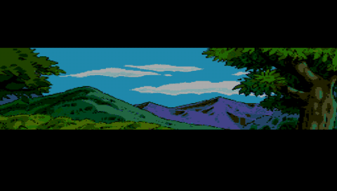

## Status: emulator beta (v0.1.1-beta)

Read these caveats before you play:

- **Made for PPSSPP.** Tested in PPSSPP 1.20.4 on macOS only.
- **Real PSP / PS Vita: untested.** The ISO's program (EBOOT) is signed again after patching, as the
  original was. But the game file the patch applies to is `CONTENT.DAT` in its decrypted form (the form PPSSPP
  reads). A console would need custom firmware that loads decrypted content. Nobody has tried it yet.
- **Played only up to the Riku region**, roughly the first third of the game. The script is LIPEMCO's complete,
  tested translation, but our port and our restyle (shorter names, no honorifics, re-wrapped lines) have not been
  checked past that point, nor has the ending.
- **Seen on screen:** every first-run prompt, the System Menu and all 18 manual pages. Rare prompts were
  translated but not seen: import/export, Memory Stick full, no Memory Stick.
- **Still in Japanese:** the old game screenshots printed inside the manual pages, the logos, and the CERO
  rating mark.
- **The game patch is large (55 MB):** the game track is stored compressed and encrypted, so one changed
  track changes the whole file.

Please report problems in this repository's issues. Say where you were in the game and include a screenshot.

## Screenshots

| | |
|---|---|
| 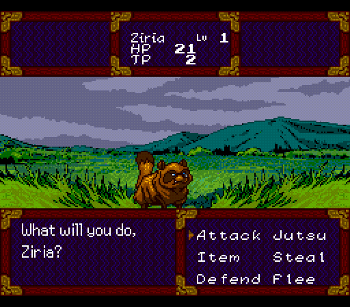 | 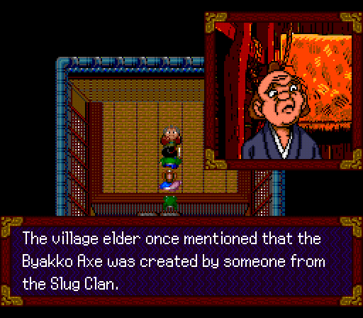 |
| 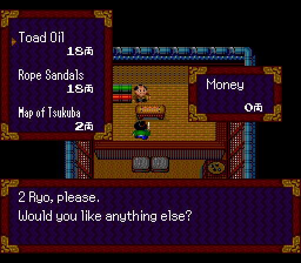 | 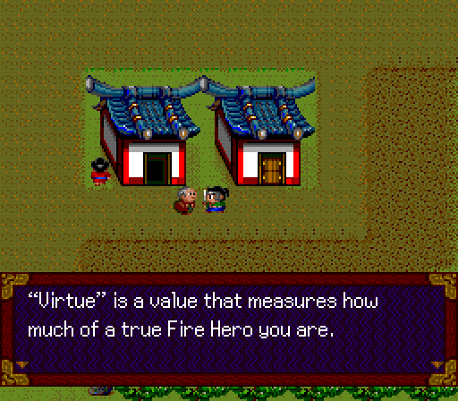 |

The emulator's prompts and System Menu (press L in game):

| | |
|---|---|
| 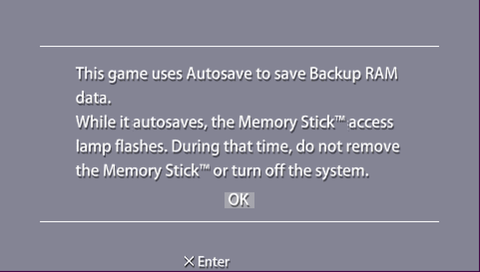 | 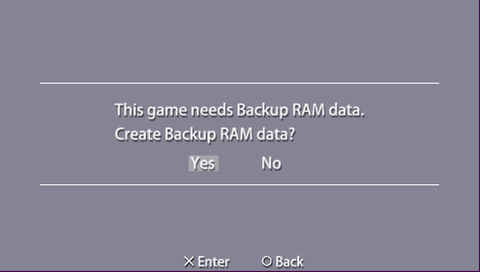 |
| 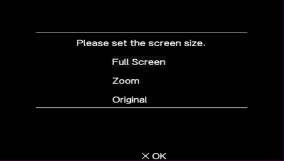 | 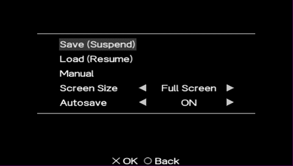 |

The manual (System Menu > Manual), all 18 pages redrawn in English:

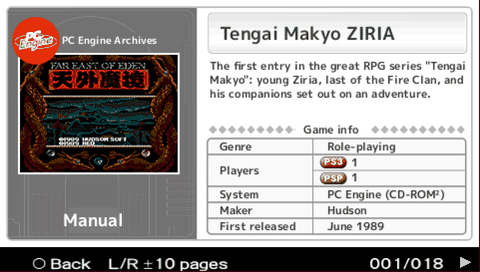

| | |
|---|---|
| 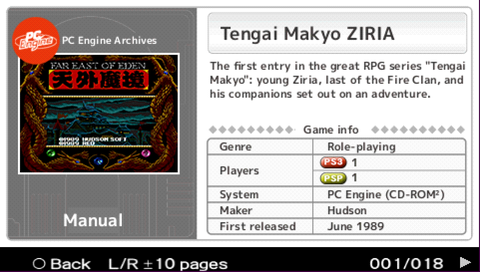 | 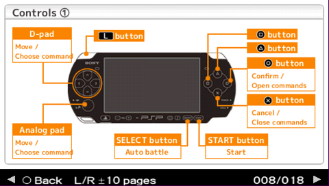 |
| 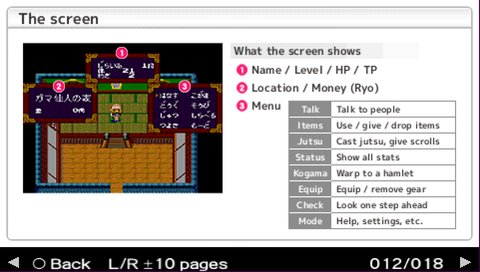 | 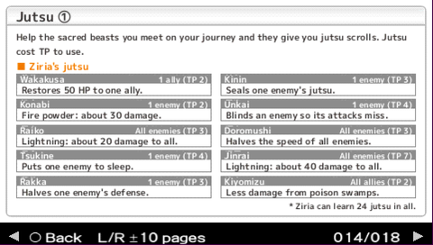 |

## What changes

- **The game is in English**, with LIPEMCO's variable-width font.
- **No honorifics:** `-sama` becomes Lord or Lady, and the other suffixes are dropped.
- **Shorter names:** Koumon becomes Komon, and King Akuro is Akuro-Ou throughout. The world is Jipang,
  experience is Virtue, and money is Ryo.
- **The emulator's prompts and menus** (autosave, save and load, screen size, the System Menu on L), the
  18 manual pages, and the XMB title and picture are in English.

## Apply the patch

There are two patches, one for each file of the release. Each needs an unmodified dump:

| File | Original SHA-1 | Patched SHA-1 | Patch |
|---|---|---|---|
| `NPJJ30029/CONTENT.DAT` (the game, decrypted as PPSSPP reads it) | `1a009332f54e283bfaedff5d073008a60b9b06c7` | `5106f44801aed9578c90f3df4099cf22c7f8ef05` | `ziria-psn-en.xdelta` |
| the ISO (`Tengai Makyou - Ziria (JPN) (PCE) (PSN) [NPJJ30029].iso`) | `a7ae6b1bb260264a03b7798ac4fad77fc51c778e` | `d080fd6a5b133a0e48ee41459376c6fe5939887a` | `ziria-psn-en-iso.xdelta` |

    xdelta3 -d -s CONTENT.DAT ziria-psn-en.xdelta CONTENT.en.DAT
    xdelta3 -d -s "Tengai Makyou - Ziria (JPN) (PCE) (PSN) [NPJJ30029].iso" ziria-psn-en-iso.xdelta "Tengai Makyo Ziria (English).iso"

GUI patchers that take xdelta (such as Delta Patcher) work too. Then:

1. Rename `CONTENT.en.DAT` to `CONTENT.DAT`.
2. Put it in `PSP/GAME/NPJJ30029/` in PPSSPP's memory stick folder, in place of the original. Keep a copy of
   both originals.
3. In PPSSPP, start the English ISO.

The `CONTENT.DAT` patch alone also works with the original ISO. The game is then in English and the emulator
prompts stay in Japanese.

## Build from source

You need:
- python 3 with Pillow
- g++, make and cmake
- libpng and ImageMagick
- xdelta3

`tools/build_sign_np.sh` builds the EBOOT signer, and `tools/build_en.sh` runs the full build (about 12
minutes). See `AGENTS.md` for the commands and `docs/status.md` for how the build works.

## Credits

- **English translation: LIPEMCO! Translations.** The game's whole English script, the variable-width font,
  the translated graphics and the PC Engine hacking are theirs:
  - **Supper**: hacking and tools
  - **TheMajinZenki**: translation
  - **cccmar** and **rg111**: testing

  Their source, published under GPLv3 as `tenmatools`, is vendored unchanged in `vendor/tenmatools`, apart
  from two build fixes for macOS and the line-wrap fix described in `docs/decisions.md`. If you enjoy this
  patch, the credit for the translation is theirs.
- **PSN port and restyle; emulator prompts, manual and XMB translation:** second-save.
- **Manual font:** M+ 1p, SIL Open Font License (`fonts/OFL.txt`).
- **EBOOT signing:** sign_np by Hykem.
- *Tengai Makyou Ziria* © 1989 Hudson Soft / Red. This project is not affiliated with the rights holders.

## Licence

GPLv3, the licence of the patch this is built from (`vendor/tenmatools/COPYING`).
